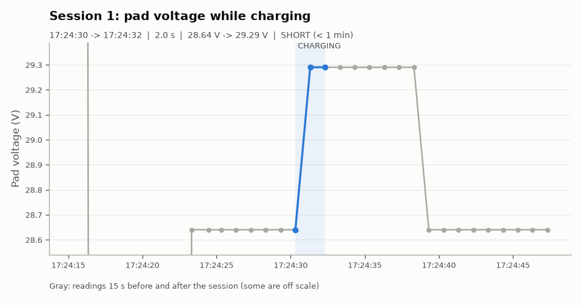
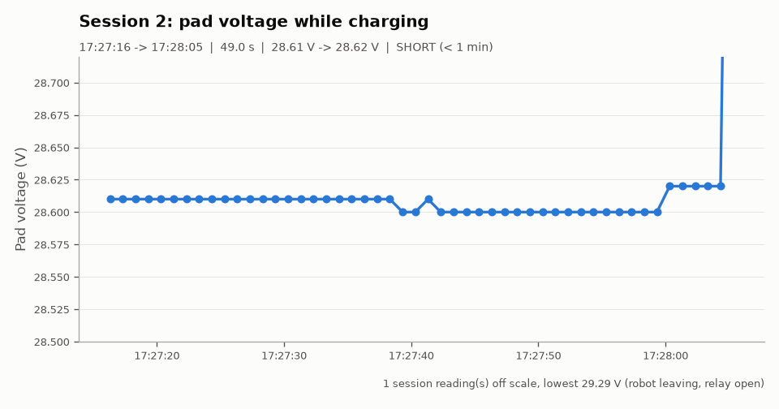

# Dock report: A_morning

**Source:** `results/A_morning/A_morning.csv`, recorded by `recorder.py` from the dock simulator (1 reading per second, so times are accurate to about 1 s).

| | |
|---|---|
| Recorded | 2026-11-11 17:19:56.323 -> 2026-11-11 17:30:25.323 (0.17 h) |
| Readings | 630 |
| NO_DATA readings | 0 (0.0 %) |
| Dock restarts seen | 0 |
| Charge sessions | 2 |
| Short sessions (< 1 min) | 2 |
| Dock messages (`A_morning_events.csv`) | 54, incl. 2 x Relay CLOSED, 7 x BAD_CONTACT, 1 x Boot |

## Sessions

| # | Start | End | Duration | Start V | End V | Max V | Readings | Longest gap | Warning |
|---|---|---|---|---|---|---|---|---|---|
| 1 | 17:24:30 | 17:24:32 | 2.0 s | 28.64 | 29.29 | 29.29 | 3 | 1.0 s | SHORT (< 1 min) |
| 2 | 17:27:16 | 17:28:05 | 49.0 s | 28.61 | 28.62 | 29.29 | 50 | 1.0 s | SHORT (< 1 min) |

## Warnings

- Session 1 (17:24:30, 2.0 s): SHORT (< 1 min)
- Session 2 (17:27:16, 49.0 s): SHORT (< 1 min)

## Charts

### Session 1

### Session 2

## How the numbers were made

- A session starts at the first CHARGING reading and ends at the last CHARGING reading. NO_DATA readings (Wi-Fi drops, restarts) do not end a session.
- Start V is the first CHARGING reading. End V is the last reading while the relay was still closed (after it opens, the robot may already be driving away).
- Sessions shorter than 1 minute are marked SHORT.
- Made by `analyze.py` on 2026-11-11 17:30.
