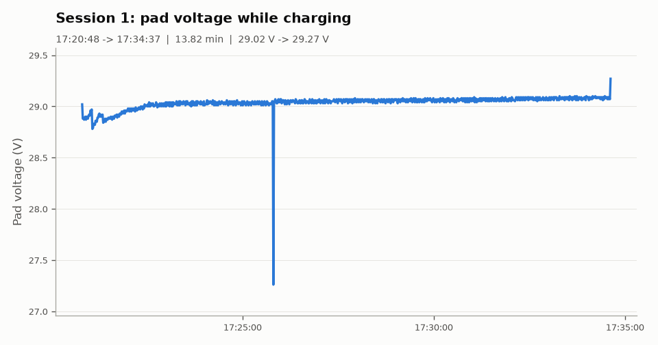

# Dock report: B_evening

**Source:** `results/B_evening/B_evening.csv`, recorded by `recorder.py` from the dock simulator (1 reading per second, so times are accurate to about 1 s).

| | |
|---|---|
| Recorded | 2026-11-11 17:19:56.344 -> 2026-11-11 17:35:25.345 (0.26 h) |
| Readings | 930 |
| NO_DATA readings | 0 (0.0 %) |
| Dock restarts seen | 0 |
| Charge sessions | 1 |
| Short sessions (< 1 min) | 0 |
| Dock messages (`B_evening_events.csv`) | 10, incl. 2 x Relay CLOSED, 0 x BAD_CONTACT, 1 x Boot |

## Sessions

| # | Start | End | Duration | Start V | End V | Max V | Readings | Longest gap | Warning |
|---|---|---|---|---|---|---|---|---|---|
| 1 | 17:20:48 | 17:34:37 | 13.82 min | 29.02 | 29.27 | 29.27 | 830 | 1.0 s |  |

## Charts

### Session 1

## How the numbers were made

- A session starts at the first CHARGING reading and ends at the last CHARGING reading. NO_DATA readings (Wi-Fi drops, restarts) do not end a session.
- Start V is the first CHARGING reading. End V is the last reading while the relay was still closed (after it opens, the robot may already be driving away).
- Sessions shorter than 1 minute are marked SHORT.
- Made by `analyze.py` on 2026-11-11 17:35.
