# Dock report: problem_partial_80min

**Source:** `results/problem_partial_80min/problem_partial_80min.csv`, recorded by `recorder.py` from the dock simulator (1 reading per second, so times are accurate to about 1 s).

| | |
|---|---|
| Recorded | 2026-11-11 17:19:56.361 -> 2026-11-11 18:39:58.632 (1.33 h) |
| Readings | 4614 |
| NO_DATA readings | 287 (6.2 %) |
| Dock restarts seen | 15 |
| Charge sessions | 16 |
| Short sessions (< 1 min) | 16 |
| Dock messages (`problem_partial_80min_events.csv`) | 426, incl. 16 x Relay CLOSED, 54 x BAD_CONTACT, 16 x Boot |

## Sessions

| # | Start | End | Duration | Start V | End V | Max V | Readings | Longest gap | Warning |
|---|---|---|---|---|---|---|---|---|---|
| 1 | 17:24:30 | 17:24:32 | 2.0 s | 28.64 | 29.29 | 29.29 | 3 | 1.0 s | SHORT (< 1 min) |
| 2 | 17:27:18 | 17:28:05 | 47.0 s | 28.61 | 28.62 | 29.29 | 44 | 3.0 s | SHORT (< 1 min) |
| 3 | 17:34:29 | 17:34:31 | 2.0 s | 28.64 | 29.29 | 29.29 | 3 | 1.0 s | SHORT (< 1 min) |
| 4 | 17:37:15 | 17:38:04 | 49.0 s | 28.61 | 28.62 | 29.29 | 46 | 3.0 s | SHORT (< 1 min) |
| 5 | 17:44:29 | 17:44:29 | 0.0 s | 29.29 | 29.29 | 29.29 | 1 | 0.0 s | SHORT (< 1 min) |
| 6 | 17:47:13 | 17:48:01 | 48.0 s | 28.61 | 28.62 | 28.62 | 44 | 3.0 s | SHORT (< 1 min) |
| 7 | 17:54:26 | 17:54:27 | 1.0 s | 28.64 | 29.29 | 29.29 | 2 | 1.0 s | SHORT (< 1 min) |
| 8 | 17:57:12 | 17:58:00 | 48.0 s | 28.61 | 29.21 | 29.21 | 49 | 1.0 s | SHORT (< 1 min) |
| 9 | 18:04:24 | 18:04:26 | 2.0 s | 28.64 | 29.29 | 29.29 | 3 | 1.0 s | SHORT (< 1 min) |
| 10 | 18:07:10 | 18:07:59 | 48.0 s | 28.61 | 29.21 | 29.21 | 45 | 3.0 s | SHORT (< 1 min) |
| 11 | 18:14:23 | 18:14:24 | 1.0 s | 28.64 | 29.29 | 29.29 | 2 | 1.0 s | SHORT (< 1 min) |
| 12 | 18:17:10 | 18:17:57 | 47.0 s | 28.61 | 28.62 | 29.25 | 46 | 2.0 s | SHORT (< 1 min) |
| 13 | 18:24:22 | 18:24:22 | 0.0 s | 29.29 | 29.29 | 29.29 | 1 | 0.0 s | SHORT (< 1 min) |
| 14 | 18:27:08 | 18:27:56 | 48.1 s | 28.61 | 28.62 | 29.25 | 44 | 3.0 s | SHORT (< 1 min) |
| 15 | 18:34:20 | 18:34:21 | 1.0 s | 28.64 | 29.29 | 29.29 | 2 | 1.0 s | SHORT (< 1 min) |
| 16 | 18:37:06 | 18:37:54 | 48.1 s | 28.61 | 28.62 | 29.25 | 39 | 11.1 s | SHORT (< 1 min) |

## Warnings

- Session 1 (17:24:30, 2.0 s): SHORT (< 1 min)
- Session 2 (17:27:18, 47.0 s): SHORT (< 1 min)
- Session 3 (17:34:29, 2.0 s): SHORT (< 1 min)
- Session 4 (17:37:15, 49.0 s): SHORT (< 1 min)
- Session 5 (17:44:29, 0.0 s): SHORT (< 1 min)
- Session 6 (17:47:13, 48.0 s): SHORT (< 1 min)
- Session 7 (17:54:26, 1.0 s): SHORT (< 1 min)
- Session 8 (17:57:12, 48.0 s): SHORT (< 1 min)
- Session 9 (18:04:24, 2.0 s): SHORT (< 1 min)
- Session 10 (18:07:10, 48.0 s): SHORT (< 1 min)
- Session 11 (18:14:23, 1.0 s): SHORT (< 1 min)
- Session 12 (18:17:10, 47.0 s): SHORT (< 1 min)
- Session 13 (18:24:22, 0.0 s): SHORT (< 1 min)
- Session 14 (18:27:08, 48.1 s): SHORT (< 1 min)
- Session 15 (18:34:20, 1.0 s): SHORT (< 1 min)
- Session 16 (18:37:06, 48.1 s): SHORT (< 1 min)

## Charts

### Session 1

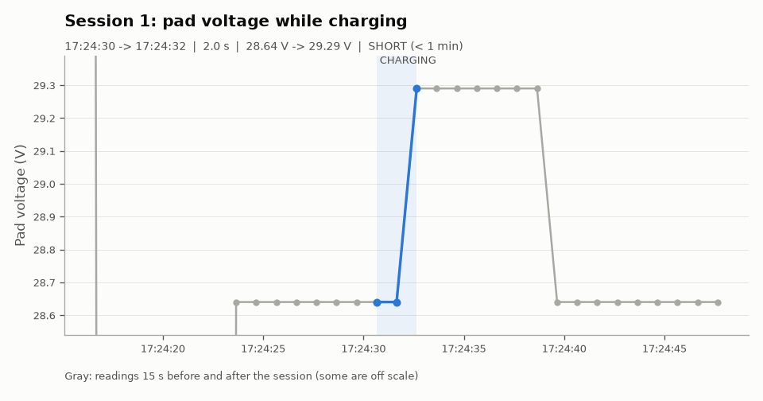

### Session 2

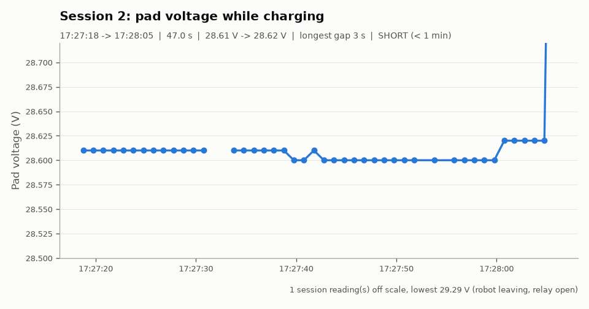

### Session 3

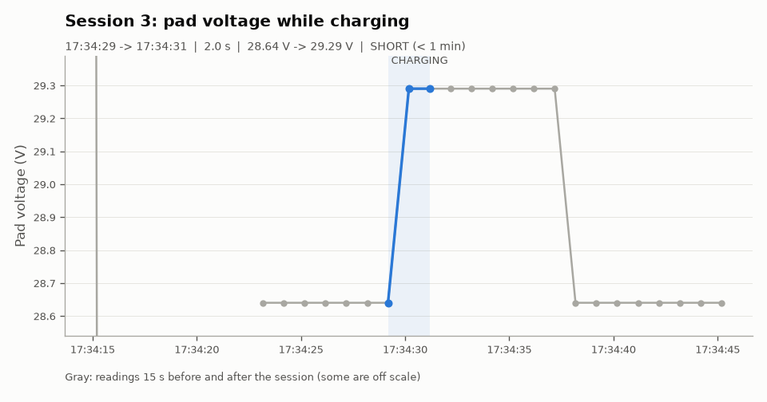

### Session 4

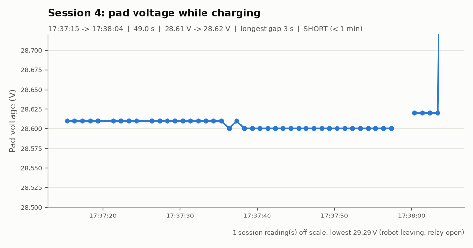

### Session 5

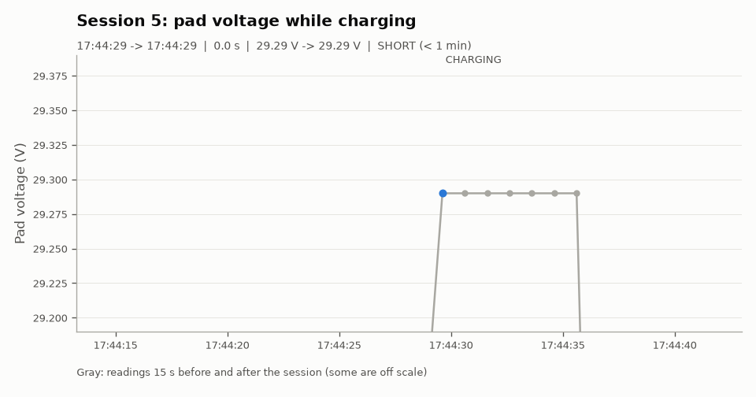

### Session 6

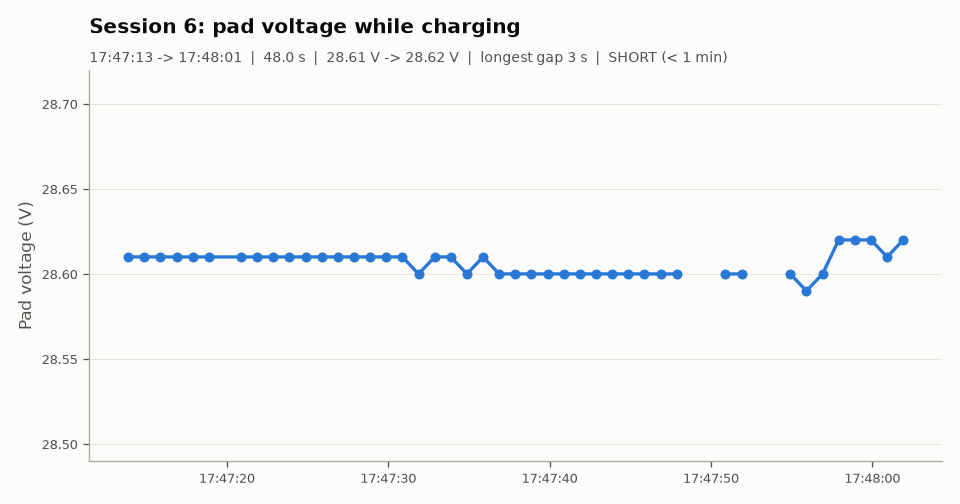

### Session 7

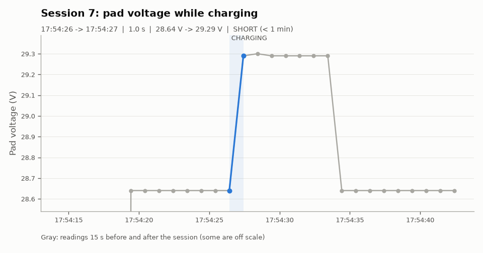

### Session 8

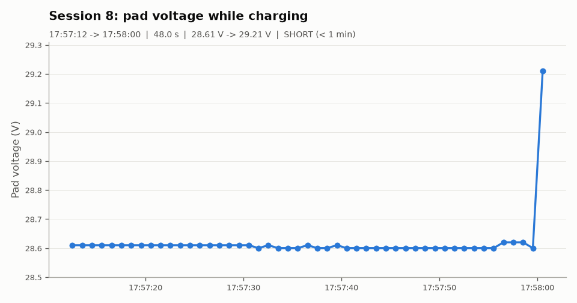

### Session 9

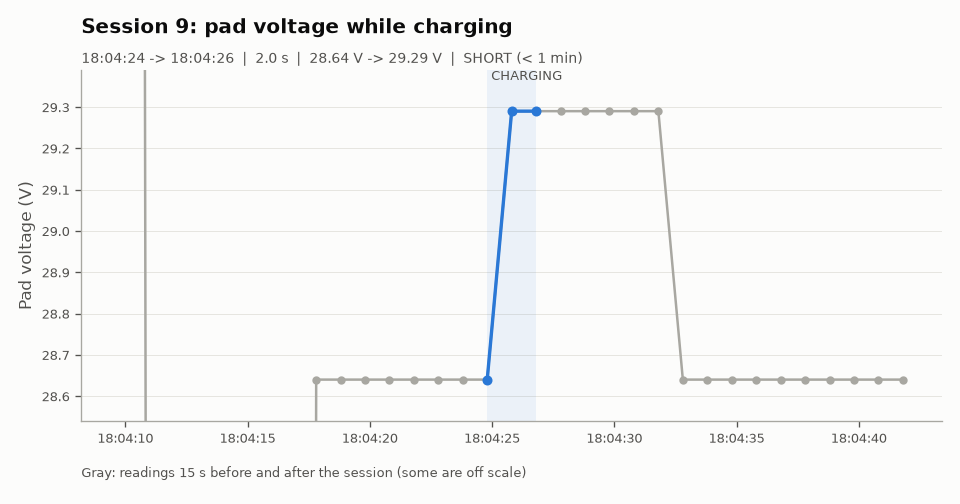

### Session 10

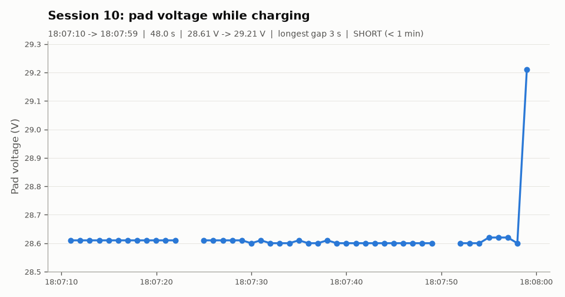

### Session 11

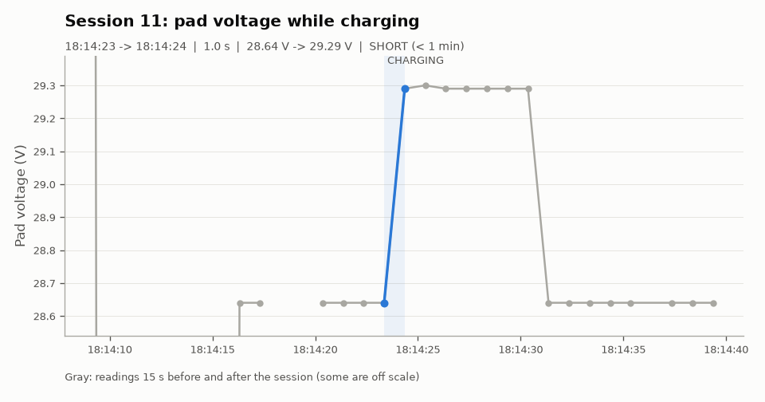

### Session 12

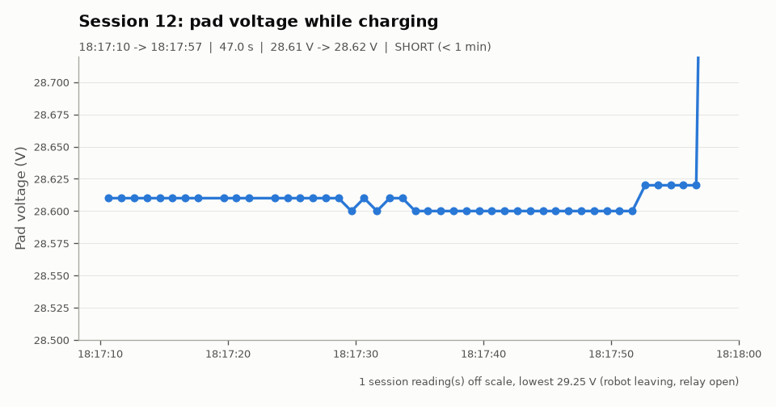

### Session 13

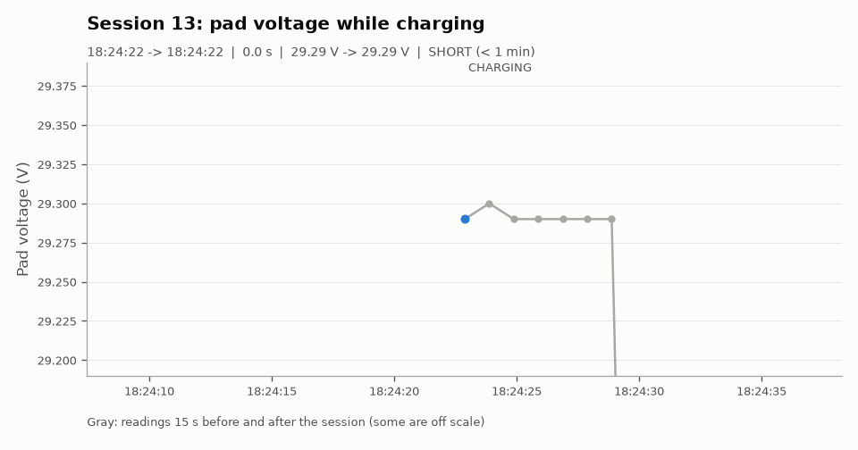

### Session 14

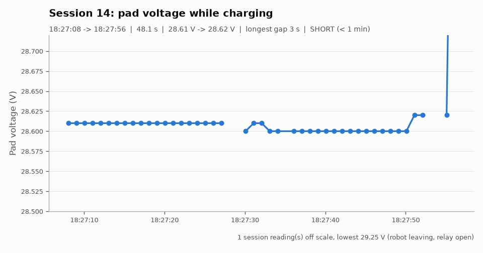

### Session 15

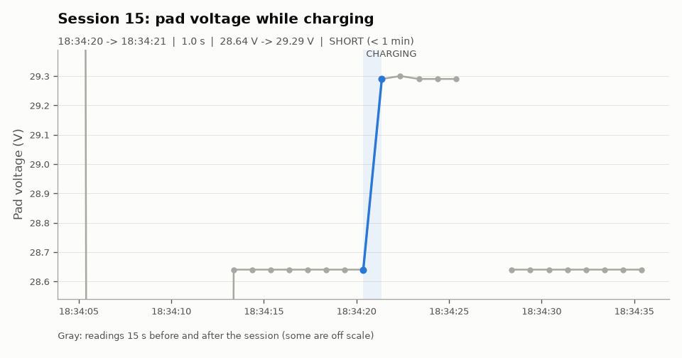

### Session 16

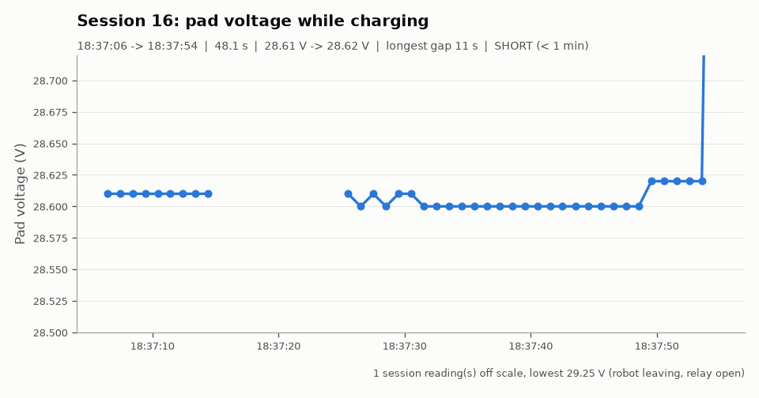

## How the numbers were made

- A session starts at the first CHARGING reading and ends at the last CHARGING reading. NO_DATA readings (Wi-Fi drops, restarts) do not end a session.
- Start V is the first CHARGING reading. End V is the last reading while the relay was still closed (after it opens, the robot may already be driving away).
- Sessions shorter than 1 minute are marked SHORT.
- Made by `analyze.py` on 2026-11-11 18:52.
