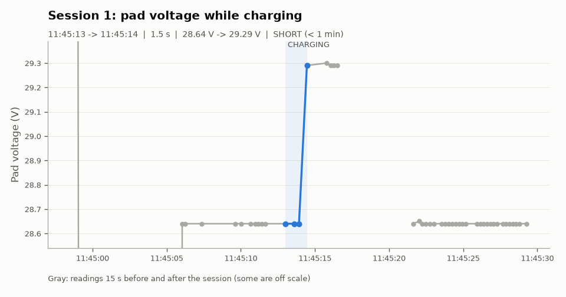
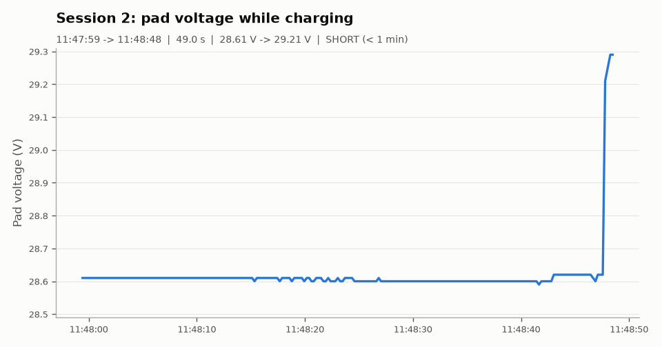

# Dock report: recording_A_morning

**Source:** original dock recording `data/recording_A_morning.csv` (about 4 readings per second).

| | |
|---|---|
| Recorded | 11:40:37.336 -> 11:50:34.784 (0.17 h) |
| Readings | 1774 |
| NO_DATA readings | 0 (0.0 %) |
| Dock restarts seen | 0 |
| Charge sessions | 2 |
| Short sessions (< 1 min) | 2 |

## Sessions

| # | Start | End | Duration | Start V | End V | Max V | Readings | Longest gap | Warning |
|---|---|---|---|---|---|---|---|---|---|
| 1 | 11:45:13 | 11:45:14 | 1.5 s | 28.64 | 29.29 | 29.29 | 4 | 0.6 s | SHORT (< 1 min) |
| 2 | 11:47:59 | 11:48:48 | 49.0 s | 28.61 | 29.21 | 29.29 | 217 | 0.4 s | SHORT (< 1 min) |

## Warnings

- Session 1 (11:45:13, 1.5 s): SHORT (< 1 min)
- Session 2 (11:47:59, 49.0 s): SHORT (< 1 min)

## Charts

### Session 1

### Session 2

## How the numbers were made

- A session starts at the first CHARGING reading and ends at the last CHARGING reading. NO_DATA readings (Wi-Fi drops, restarts) do not end a session.
- Start V is the first CHARGING reading. End V is the last reading while the relay was still closed (after it opens, the robot may already be driving away).
- Sessions shorter than 1 minute are marked SHORT.
- Made by `analyze.py` on 2026-11-11 17:30.
