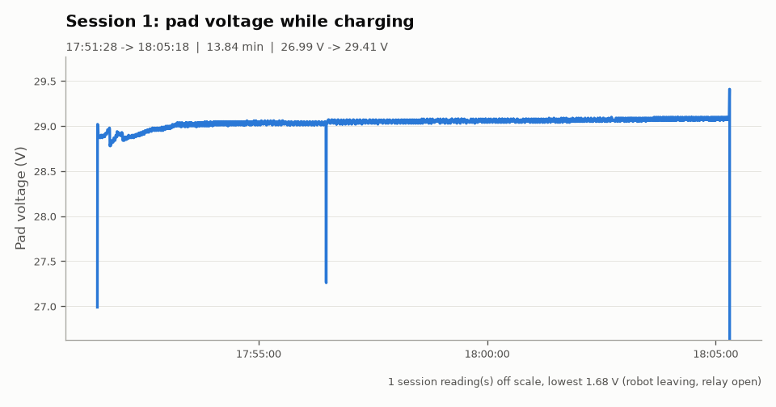

# Dock report: recording_B_evening

**Source:** original dock recording `data/recording_B_evening.csv` (about 4 readings per second).

| | |
|---|---|
| Recorded | 17:50:34.299 -> 18:05:34.074 (0.25 h) |
| Readings | 3925 |
| NO_DATA readings | 0 (0.0 %) |
| Dock restarts seen | 0 |
| Charge sessions | 1 |
| Short sessions (< 1 min) | 0 |

## Sessions

| # | Start | End | Duration | Start V | End V | Max V | Readings | Longest gap | Warning |
|---|---|---|---|---|---|---|---|---|---|
| 1 | 17:51:28 | 18:05:18 | 13.84 min | 26.99 | 29.41 | 29.41 | 3648 | 2.5 s |  |

## Charts

### Session 1

## How the numbers were made

- A session starts at the first CHARGING reading and ends at the last CHARGING reading. NO_DATA readings (Wi-Fi drops, restarts) do not end a session.
- Start V is the first CHARGING reading. End V is the last reading while the relay was still closed (after it opens, the robot may already be driving away).
- Sessions shorter than 1 minute are marked SHORT.
- Made by `analyze.py` on 2026-11-11 17:35.
